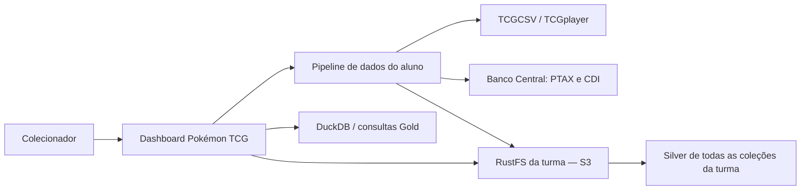
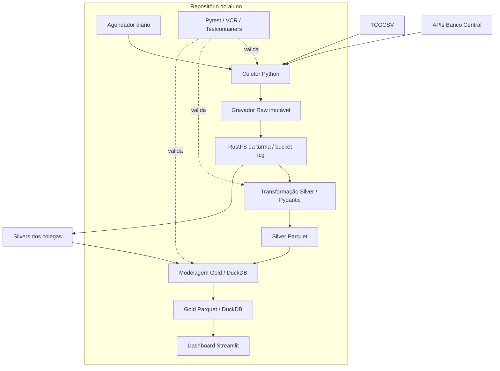

# Plano de arquitetura — versão inicial

## Diagrama C4 — Contexto

## Diagrama C4 — Contêineres

## Decisões arquiteturais pendentes
- ADR para particionamento e chave dos objetos brutos.
- ADR para estratégia de construção/reconstrução da Silver e Gold.
- ADR para esquema estrela e grãos das tabelas.
- ADR para regra de seleção da carteira `propria` e fallback de produto selado.
- ADR para operação do job (GitHub Actions ou Railway).

## Restrições conhecidas
- O RustFS da turma e as silvers dos colegas são sistemas externos.
- Nenhum segredo pode ser armazenado no Git.
- A PTAX aplicada a cada preço não pode ser posterior à data do preço.
- A gravação de Raw é imutável; Silver e Gold são derivadas e reprocessáveis.
